# Muhr

Proof that a file existed on a given day and has not changed since: SHA-256, an open Merkle log and Bitcoin
through OpenTimestamps. No coin, no custody.

[](https://www.bestpractices.dev/projects/16668)
[](https://scorecard.dev/viewer/?uri=github.com/wonmortech/muhr)
[](https://github.com/wonmortech/muhr/actions/workflows/ci.yml)
[](https://developer.mozilla.org/en-US/observatory/analyze?host=muhr.wonmor.io)
[](https://www.ssllabs.com/ssltest/analyze.html?d=muhr.wonmor.io)

**[Website](https://muhr.wonmor.io) · [Live demo](https://wonmor.io/demo/muhr/) · [Plan](docs/PLAN.md) · [Releases](https://github.com/wonmortech/muhr/releases)**

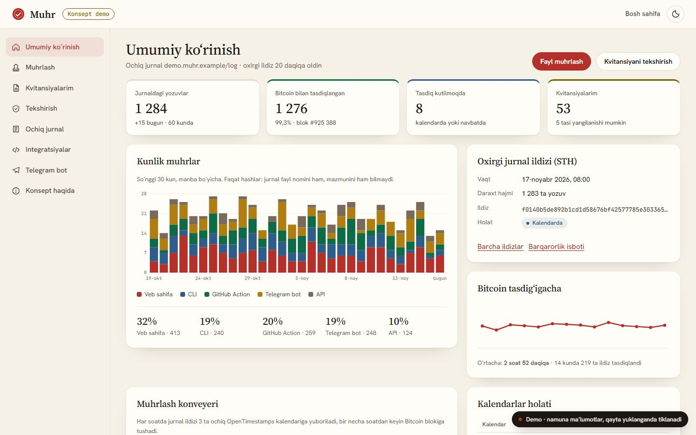

> **Status: planning.** There is no CLI, API, log or bot yet. The [live demo](https://wonmor.io/demo/muhr/) is the
> planned product UI on fictional data: the SHA-256 hashing and the RFC 9162 Merkle maths in it are real, the
> OpenTimestamps calendars and Bitcoin confirmations are simulated. Muhr (Uzbek for *seal*) will be open source.

## What it does

- **Stamp any file.** It is hashed on your device; only the 32-byte hash goes to the log. Salted hashes for short secrets.
- **Open, append-only log.** RFC 9162 style Merkle log with hourly tree heads, inclusion and consistency proofs.
- **Anchored in Bitcoin.** Every tree head goes to three public OpenTimestamps calendars and lands in a block within hours.
- **Receipts you keep.** `.muhr.json` (inclusion proof) plus the `.ots` file. No account needed.
- **Verify without us.** Browser, CLI or Telegram bot; the check needs the file, the receipt and Bitcoin block headers.
- **Honest limits.** It proves *when*, not *who*: no author, no content truth, no notarised date. EIMZO signatures are shown, not verified.

## Screenshots

| | |
|---|---|
| 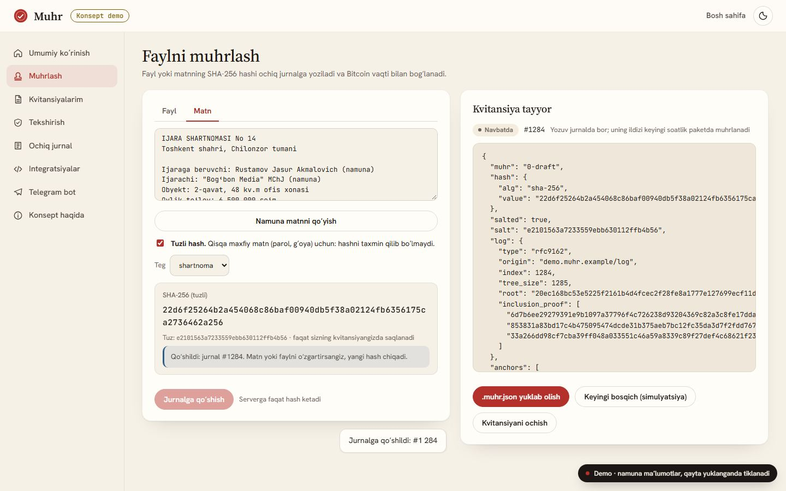 | 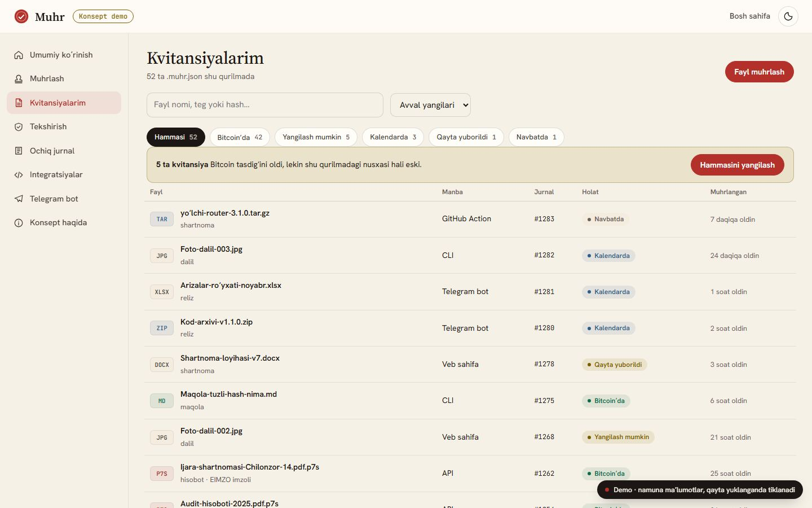 |
| Stamp text or a file: the hash is computed locally and a receipt comes back at once. | Receipts on this device, filtered by state: in Bitcoin, upgradable, in a calendar, retried, queued. |
| 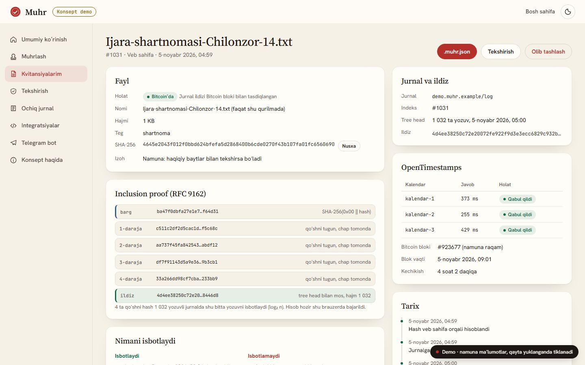 | 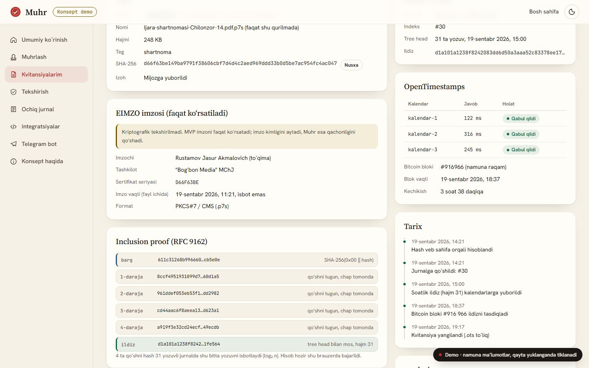 |
| One receipt: the inclusion proof is recomputed in the browser, calendars and the Bitcoin block are listed. | An EIMZO-signed `.p7s`: the signature is displayed and clearly marked as not cryptographically checked. |
| 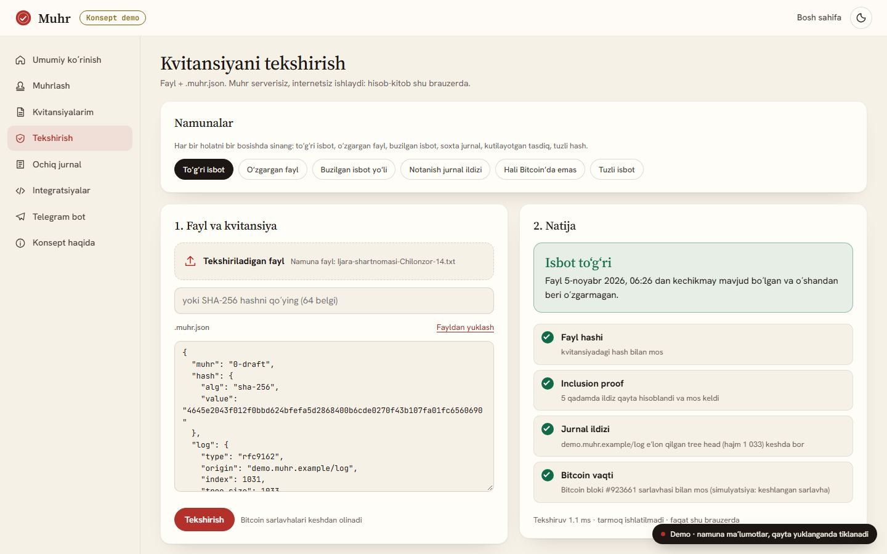 | 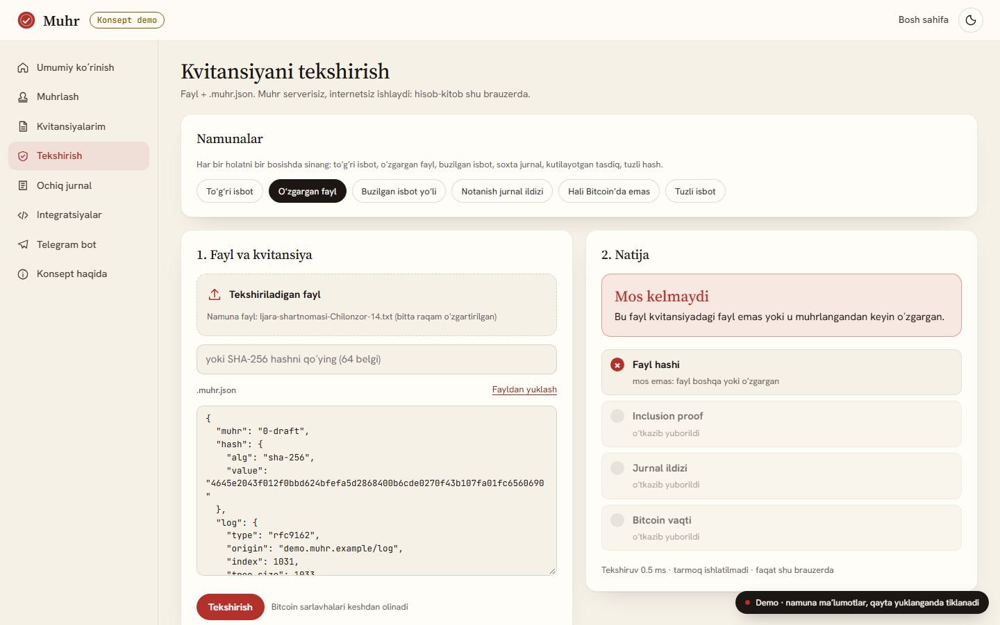 |
| The offline verifier: hash, inclusion proof, known tree head, Bitcoin header. | One changed digit in the file and the check fails at the first step. |
| 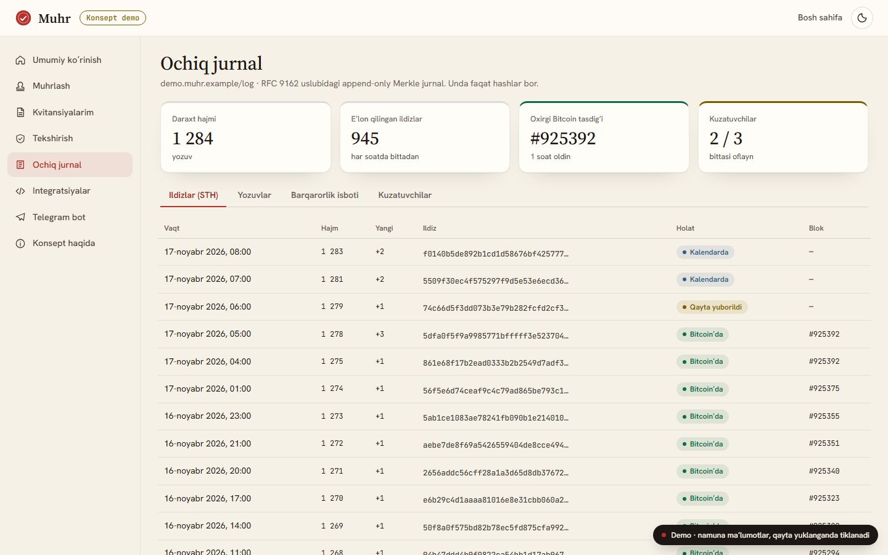 | 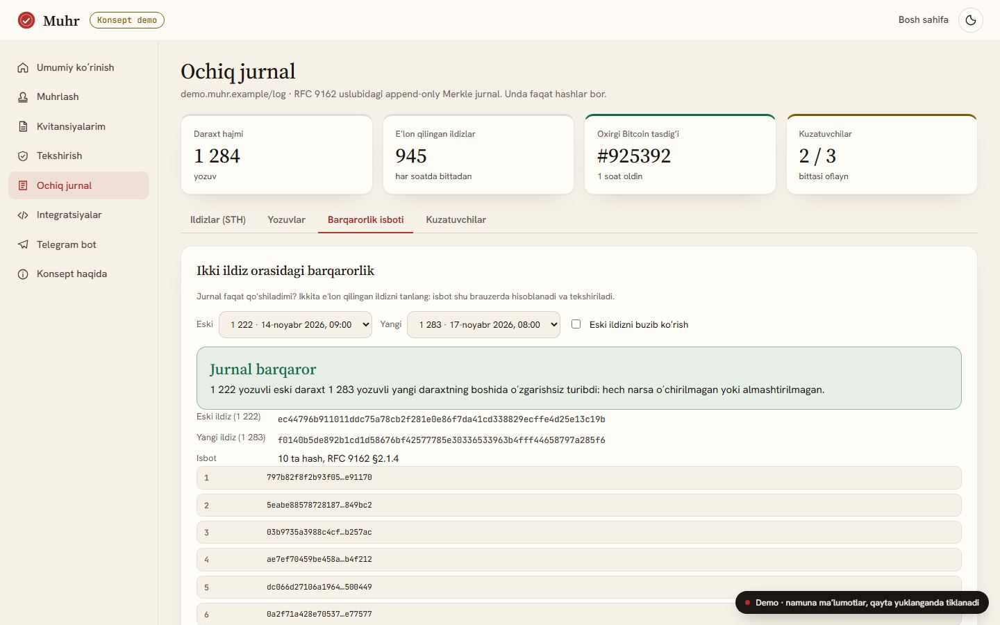 |
| The public log: hourly tree heads with their anchoring state. | A real RFC 9162 consistency proof between any two published heads. |
| 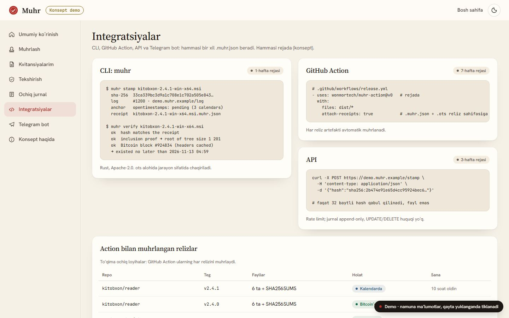 | 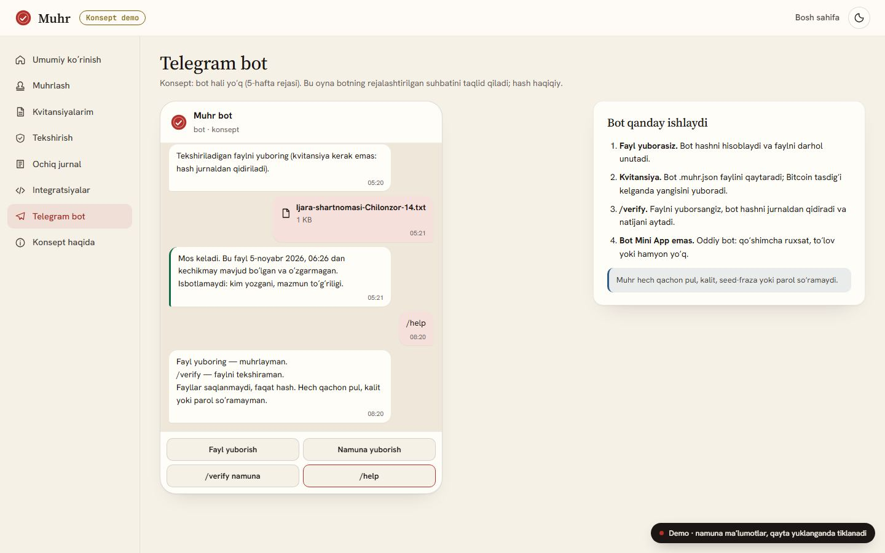 |
| Planned CLI, GitHub Action and API, with releases stamped by the Action. | The planned Telegram bot: send a file, get a receipt; `/verify` checks it. |
| 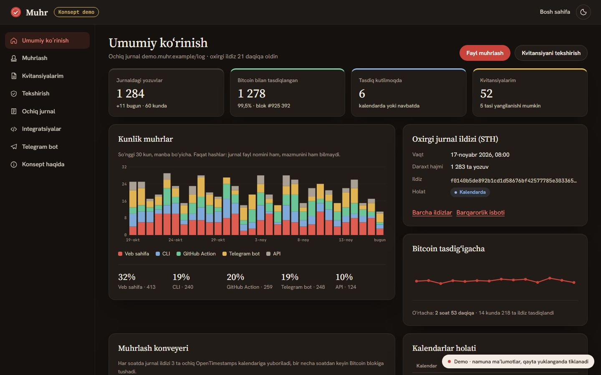 | 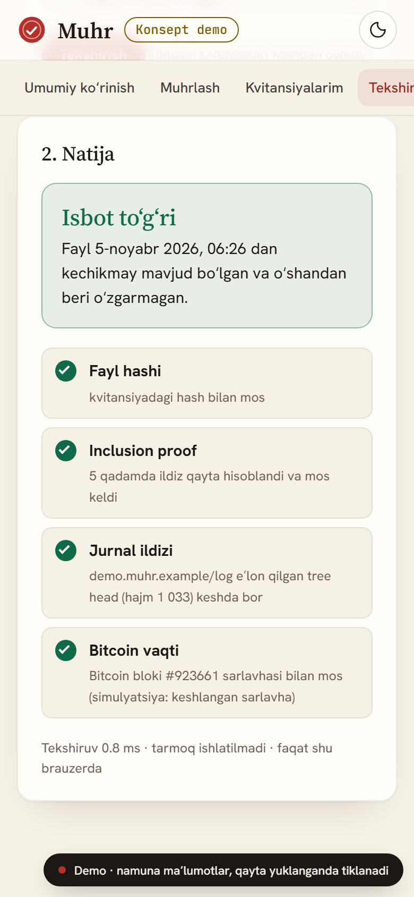 |
| Dark theme. | The verifier on a phone. |

## How verification will work

1. You hash the file locally (browser or CLI). Only the hash leaves your device.
2. The hash is appended to the open Merkle log, and you get an inclusion proof.
3. Every hour the log root is timestamped through public OpenTimestamps calendars; a few hours later it is in a Bitcoin block.
4. You keep `.muhr.json` and the `.ots` file.
5. Anyone verifies them with the open `ots` client and Bitcoin block headers, even if Muhr's server disappears.

Muhr never holds, sends, sells or issues crypto-assets, and it will never ask for money, keys or seed phrases.
Why this matters in Uzbekistan (fake verification sites, signatures that say *who* but not *when*):
[docs/research/legal.md](docs/research/legal.md).

## Try the demo locally

```sh
npm ci --ignore-scripts && npm run demo   # http://127.0.0.1:4174/demo/muhr/
```

Every page runs on fictional data (relative dates, so it never ages); changes stay in memory and reset on reload.

## Docs

- [Plan](docs/PLAN.md): goals, architecture, the 8-week MVP, risks, open questions
- [Research](docs/research/README.md) (Uzbek): competitors, references, legal notes, inspiration
- [Design direction](DESIGN.md) · [Assurance case](docs/ASSURANCE.md)
- [Security](SECURITY.md) (private reports, [verifying a release](SECURITY.md#verifying-a-release)) ·
  [Governance](GOVERNANCE.md) · [Changelog](CHANGELOG.md)

## Development

`site/` is the home page (https://muhr.wonmor.io): plain HTML, CSS and JS, self-hosted fonts, a strict CSP, no build
step. `demo/` is the concept demo; `tools/build-demo.mjs` copies it with the shared core into `dist/demo/muhr/`
and never touches `site/`.

```sh
node tools/pages.mjs       # regenerate site/index.html, site/en/, site/ru/, site/404.html from one template
npm run lint               # ESLint, no warnings allowed
npm test                   # unit + browser tests, then the combined coverage gate over site/ JavaScript
npm run test:demo          # demo smoke test: every screen under the production CSP, no console errors
npm run site:screenshots   # rebuild docs/screenshots/ from the demo
```

## Contributing

Issues and pull requests are welcome. Start with [CONTRIBUTING.md](CONTRIBUTING.md), and look for issues labelled
[good first issue](https://github.com/wonmortech/muhr/labels/good%20first%20issue). Every commit needs a
`Signed-off-by` line (`git commit -s`).

## License

Apache-2.0. The planned `muhr-action` will be MIT and the `.muhr.json` spec CC BY 4.0. Fonts in `site/fonts/` are
under the SIL Open Font License. Every file carries SPDX information, checked by [REUSE](https://reuse.software/) in CI.

---

A [Wonmor](https://wonmor.io) project. Sister projects: [Sanad](https://sanad.wonmor.io) and [Shaffof](https://shaffof.wonmor.io).
