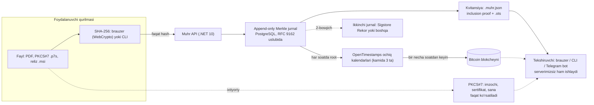

# Muhr: reja

> **Holat:** 2026-11-13, reja bosqichi. Kod yoʻq, reliz yoʻq, foydalanuvchi yoʻq. Bu hujjat Wonmor web3 tadqiqotining Muhr qismiga (§7.1, §8, §9) asoslangan; manbalar [research/references.md](research/references.md) da.

## 1. Maqsadlar

1. Istalgan faylning hashini Bitcoin vaqti va ochiq jurnal bilan bogʻlab, **serverimizsiz tekshiriladigan** kvitansiya berish.
2. EIMZO bilan imzolangan hujjatlar uchun **sana** qatlamini qoʻshish: imzoni almashtirmasdan, uning yoniga.
3. Open-source relizlar va maqolalarni avtomatik muhrlash (GitHub Action).
4. Hamma narsani ochiq qilish: kod (Apache-2.0), format spetsifikatsiyasi (CC BY 4.0), tahdid modeli.

## 2. Maqsad emas (non-goals)

- ❌ **Token, tanga, airdrop yoʻq.** Hech qachon.
- ❌ **Custody yoʻq:** kalit, kripto-aktiv yoki foydalanuvchi pulini ushlamaymiz.
- ❌ Foydalanuvchidan kripto toʻlov olmaymiz; pullik xizmat boʻlsa, somda, odatiy dasturiy xizmat sifatida.
- ❌ Oʻz OpenTimestamps kalendarimizni yuritmaymiz (BTC sotib olish kerak boʻladi), faqat ochiq kalendarlar.
- ❌ "Notarial tasdiq" yoki "sudda qabul qilinadi" vaʼdasi yoʻq. Isbot qoʻshimcha, mustaqil tekshiriladigan dalil.
- ❌ MVPʼda EIMZO imzosini kriptografik tekshirmaymiz: faqat koʻrsatamiz va "kriptografik tekshirilmadi" deb belgilaymiz.
- ❌ Fayl mazmunini serverga yubormaymiz va saqlamaymiz.
- ❌ Asoschining asosiy ish joyiga tegishli hech qanday kod, maʼlumot yoki ichki tizim ishlatilmaydi.

## 3. Arxitektura

**Komponentlar va stek**

| Qism | Texnologiya | Litsenziya | Izoh |
|---|---|---|---|
| CLI `muhr stamp/verify` | Rust | Apache-2.0 | `ots` alohida jarayon sifatida chaqiriladi (LGPL kodi aralashmaydi) |
| API `POST /stamp {hash}`, `GET /proof/{hash}` | .NET 10, PostgreSQL | Apache-2.0 | Rate limit; jurnal append-only, UPDATE/DELETE huquqi olib tashlanadi |
| Merkle jurnal | RFC 9162 formati; kutubxona nomzodi Tessera | Apache-2.0 | Jurnal ildizlari ham OTS bilan muhrlanadi |
| Tekshiruvchi sahifa | Statik HTML/JS, WebCrypto | Apache-2.0 | Oflayn rejim; "nimani isbotlaydi / nimani isbotlamaydi" bloki |
| Telegram bot | Oddiy bot (Mini App emas) | Apache-2.0 | Fayl → kvitansiya; `/verify` |
| `wonmortech/muhr-action` | GitHub Action | MIT | Reliz artefaktlarini muhrlash |
| `wonmortech/muhr-spec` | `.muhr.json` spetsifikatsiyasi | CC BY 4.0 | Versiyalangan format |

**`.muhr.json` v0 (qoralama, oʻzgaradi):** `muhr` (versiya), `hash {alg, value}`, ixtiyoriy `salted`, `log {type, origin, index, inclusion_proof, root}`, `anchors [{type: "opentimestamps", ots: base64}]`. Fayl nomi kvitansiyaga faqat foydalanuvchi xohlasa yoziladi.

## 4. MVP: 8 hafta (yakka, kechqurunlari)

| Hafta | Natija | Tayyor boʻlish mezoni |
|---|---|---|
| 1 | `muhr` Rust CLI: SHA-256 + `ots stamp/verify` oʻrami. **Dogfooding:** bitg relizlari va wonmor.io dagi 3 ta maqola qoʻlda muhrlanadi | `.ots` fayllar repoda; uchinchi shaxs ularni `ots verify` bilan tekshira oladi |
| 2 | Merkle jurnal (PostgreSQL, append-only), inclusion proof, `.muhr.json` v0 | Consistency va inclusion testlari; formatning birinchi qoralamasi `muhr-spec` da |
| 3 | .NET API: `POST /stamp`, `GET /proof/{hash}`, rate limit, har soatlik OTS root cron | 3 ta kalendar, qayta urinish; jurnal ildizi har soat muhrlanadi |
| 4 | Tekshiruvchi sahifa: brauzerda hash, drag-and-drop, oflayn rejim, cheklovlar bloki | Internetsiz tekshirish ishlaydi (Bitcoin sarlavhalari kvitansiyada yoki mahalliy) |
| 5 | Telegram bot: fayl → kvitansiya; `/verify` | Bot faylni saqlamaydi, faqat hashni hisoblaydi |
| 6 | PKCS#7 koʻrsatuvchi: sertifikat, imzochi, sana; "kriptografik tekshirilmadi" belgisi | EIMZO namunasi bilan sinalgan |
| 7 | GitHub Action: reliz artefaktlarini avtomatik muhrlash (bitg CIʼga ulanadi), reproducible build eslatmalari | bitg navbatdagi relizida avtomatik muhr |
| 8 | Xavfsizlik sahifasi, `security.txt`, tahdid modeli, wonmor.io research posti, **v0.1 reliz** | Post: *"Proving when, not who: timestamping signed documents without a coin"* |

## 5. v1 va keyin

| Bosqich | Nima |
|---|---|
| v0.2 | Tuzli (salted) hash rejimi brauzer va CLIʼda; kvitansiya formati v1 |
| v1 | Jurnal ildizlari ikkinchi ochiq jurnalga (Sigstore Rekor yoki boshqa); jurnalni mustaqil kuzatuvchi (monitor) |
| v1 | Ixtiyoriy RFC 3161 vaqt tamgʻasini OTS yoniga qoʻshish |
| Keyin | Biznes API: hajm, SLA, mijoz serverida oʻrnatish; toʻlov somda (Payme/Click) |
| Keyin | `stamp_hash` MCP tool: agentlar oʻz natijasini muhrlaydi |
| Keyin | dtwin ADRʼlari va oylik eksportlar, teletwin chatidan muhrlash |
| Keyin | Sanad bilan umumiy yadro (jurnal, kalitlar, xavfsizlik sahifasi) |
| Tadqiqot | EIMZO algoritmlari uchun ochiq tekshirish kutubxonasi; topilsa, imzoni kriptografik tekshirish |

## 6. Muvaffaqiyat oʻlchovlari (8 hafta oxirida)

- bitg va wonmor.io relizlarining **100%** muhrlangan.
- **3** ta tashqi repo GitHub Actionʼni ulagan.
- **500** ta muhr.
- Isbotni Wonmor serverisiz qayta chiqarish yoʻriqnomasini **uchinchi shaxs** sinab koʻrgan.
- Serverda **0** ta shaxsiy maʼlumot.

## 7. Xavflar va choralar

| Xavf | Chora |
|---|---|
| OTS kalendarlari ishlamay qolishi | Kamida 3 ta kalendar, kechiktirilgan qayta urinish, ildizlar ikkinchi jurnalga ham yoziladi |
| Foydalanuvchi isbotni notoʻgʻri talqin qiladi | Har kvitansiyada va sahifada "vaqtni isbotlaydi, muallifni emas" bloki |
| Kichik maxfiy matnni hash orqali taxmin qilish | Brauzerda tuzli hash; tuz foydalanuvchida qoladi |
| Jurnal operatori (biz) yozuvni oʻchirishi yoki oʻzgartirishi | Append-only, consistency proof, ildizlar Bitcoin va ikkinchi jurnalda; mustaqil monitor |
| Ish beruvchi bilan toʻqnashuv | Asosiy ish joyiga tegishli hech narsa ishlatilmaydi; yozma ruxsat soʻraladi |
| "Kripto loyiha" obroʻ xavfi | Bitcoin faqat vaqt manbai sifatida tilga olinadi; "tanga yoʻq" birinchi ekranda |
| Huquqiy noaniqlik | Yurist savollari ([research/legal.md](research/legal.md) §4) javobi kelguncha faqat ochiq kod va oʻzimizda sinash |
| Spam va suiisteʼmol (API) | Rate limit; faqat 32 baytli hash qabul qilinadi, kontent emas |

## 8. Ochiq savollar

1. Yurist javoblari: hash muhrlash litsenziyalanadigan faoliyatmi, somda API, ZRU-1003 boʻyicha dalil maqomi, shaxsiy maʼlumot (batafsil [legal.md](research/legal.md)).
2. EIMZO algoritmlari (Oʻzbekiston davlat standarti) uchun ochiq tekshirish kutubxonasi bormi? Ildiz sertifikatlarini ommaviy olsa boʻladimi?
3. Jurnal kutubxonasi: Tessera (Go) yoki .NETʼda oʻz RFC 9162 implementatsiyasi?
4. Server qayerda turadi (Oʻzbekiston yoki chet el) va bu ZRU-547 ga qanday taʼsir qiladi?
5. Repo `wonmortech/muhr` qachon ochiq qilinadi va kim maintainer?
6. Brend nomi: **Muhr** (asosiy), muqobillar Tamgʻa, Isbot. Egasi tasdiqlashi kerak.

## 9. Birinchi dogfooding (1-hafta)

| Nima | Qanday | Natija qayerda |
|---|---|---|
| **bitg relizlari** | Har reliz faylining SHA-256 (`SHA256SUMS`) va `.ots` fayli; keyin 7-haftada GitHub Action bilan avtomatik | Reliz sahifasida `.ots` va `.muhr.json` |
| **wonmor.io maqolalari** | Har maqolaning nashr qilingan matni (Markdown manbasi) hashlanadi va muhrlanadi; maqola ostida "muhrlangan" belgisi va kvitansiya havolasi | Maqola sahifasi va `muhr-spec` misollari |
| **Muhr hujjatlari** | Ushbu reja va tadqiqot fayllari ham muhrlanadi | Repo ichida `proofs/` |

Mezon: birorta ham isbotni tekshirish uchun Wonmor serveri kerak boʻlmasin.
